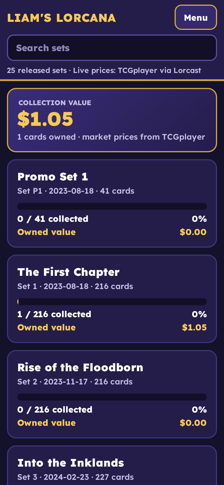
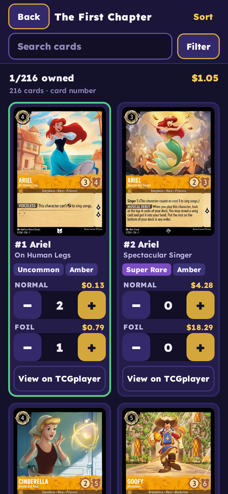

# Lorcana Tracker

A mobile-first Disney Lorcana card collection tracker. Browse every released set, see real card images, and track normal and foil copies with TCGplayer market prices and collection value. Sort sets and cards; official set logos in `assets/sets/` (via the Lorcana Fandom wiki).

- Live data from the [Lorcast API](https://lorcast.com/docs/api), with a bundled snapshot (`data/`) as an offline fallback
- Search, plus filters for owned/missing, rarity and ink
- Collection is saved in your browser (localStorage), with JSON export/import
- Static site: no build step. Served via GitHub Pages: https://laim-1.github.io/lorcana-tracker/

Card images and data are © Disney / Ravensburger, provided via Lorcast. This is an unofficial fan project.

 

## Deploying

Edit `index.html.tmpl` (not `index.html`), then run `tools/stamp.sh` before committing. It writes a new version into `index.html` (cache-busting `?v=` URLs) and `version.json`; open pages auto-reload once when a newer version is live.

## Play mode (vs AI)

Tap **Play** on the home screen. Pick a starter deck, auto-build one from your collection, or make your own in the deck builder (any of the 3,263 cards, 60+ cards, max 4 copies, up to 2 inks). The rules engine (`js/engine.js`) covers the core rules and keywords; card text abilities are parsed into a pattern library. See `COVERAGE.md` for exact numbers and what is not simulated yet. Tests: `node tests/engine.test.js`. Coverage report: `node tools/coverage.js`.
